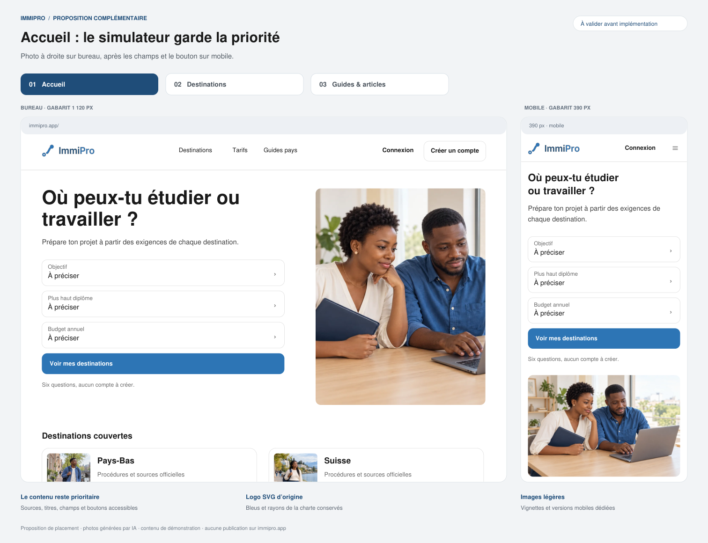
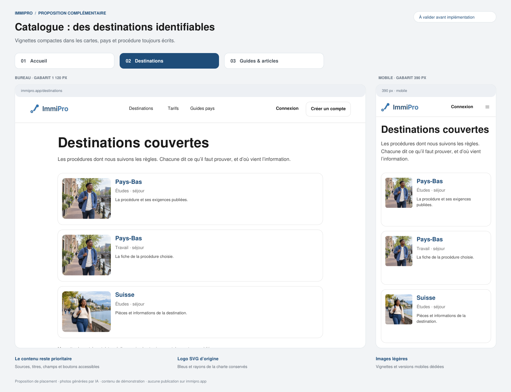
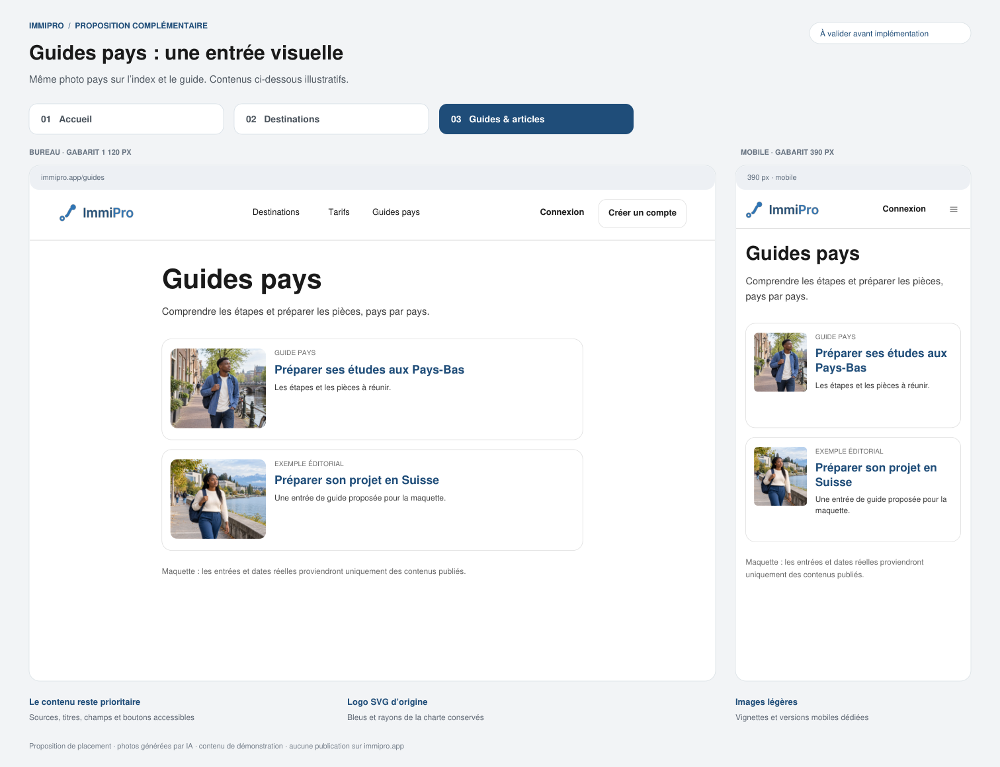
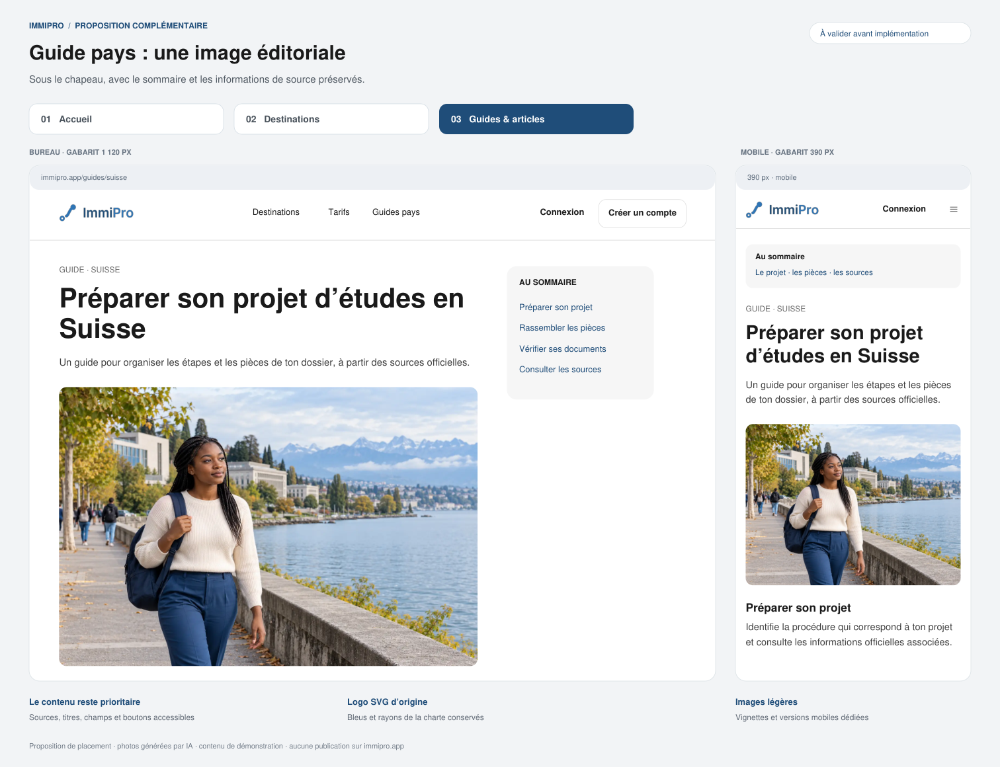
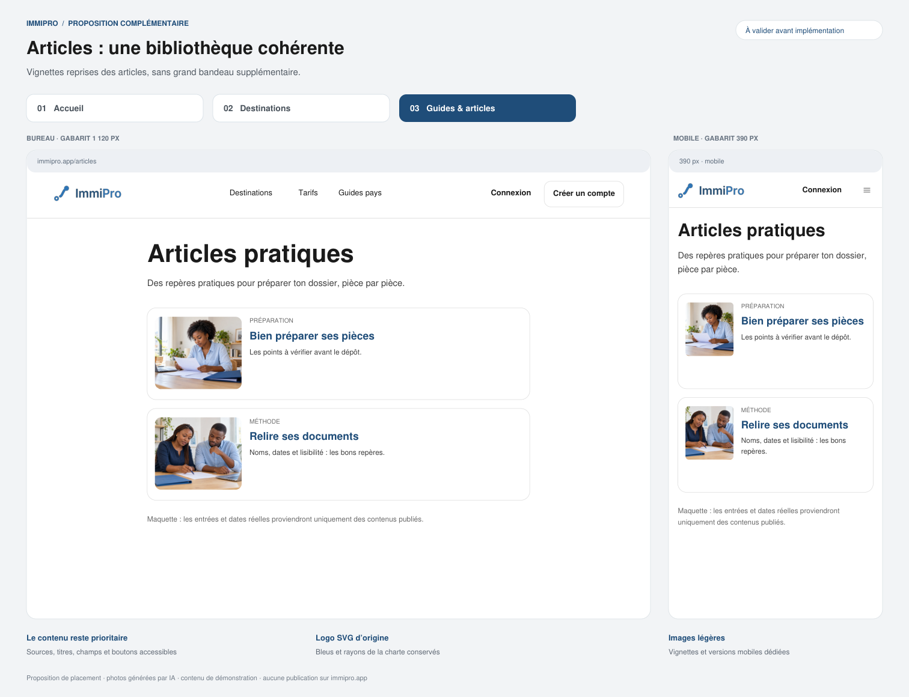

# ImmiPro — Proposition complète des images, à valider avant implémentation

**15 octobre 2026.** Les trois propositions initiales sont validées par le
responsable : préparation / Comment ça marche, fiche Pays-Bas, article pratique.
La présente extension reste une proposition. Aucune page de l’application
ni configuration de production n’a été modifiée.

**Accès rapide : [Accueil](planche-accueil.png) · [Catalogue destinations](planche-destinations.png) · [Guides](planche-guides-index.png) · [Guide pays](planche-guide-suisse.png) · [Articles](planche-articles-index.png).**

## 1. L’accueil : priorité au simulateur

**Bureau :** conserver le titre, les trois champs et le bouton à gauche ;
photo humaine à droite, sur fond clair et sans texte superposé. Une seule
photo fixe. Les cartes des destinations peuvent reprendre une petite vignette.

**Mobile :** titre, trois champs, bouton « Voir mes destinations » et sa
mention passent avant la photo. La photo vient ensuite, puis les destinations.
Aucun carrousel ni photo en arrière-plan des champs. Le repli sur une colonne
sans image conserve intégralement le parcours.

Cette extension est à valider explicitement : `AccueilSimulateur.tsx` retient
actuellement un simulateur sans photo concurrente dans le premier écran.
La proposition conserve cette priorité sur mobile et utilise l’espace latéral
sur bureau. L’ajout de l’image ne change ni les questions ni leur conservation
S.164, ni les règles d’éligibilité.

## 2. Répartition des photos

| Famille | Emplacement proposé | Image | État |
|---|---|---|---|
| Accueil `/` | Droite bureau ; après formulaire mobile ; petites vignettes dans les destinations | Nouvelle scène accueil ; Pays-Bas/Suisse en vignette | À valider |
| Comment ça marche | Après introduction, avant les étapes | Préparation | Déjà validé |
| Catalogue `/destinations` | Vignette dans chaque carte ; pays et procédure restent écrits | Image du pays | À valider |
| Fiche destination | Après l’encadré de source officielle, avant les conditions | Pays-Bas ou Suisse | Placement Pays-Bas validé ; Suisse proposée |
| Index `/guides` | Petite vignette par guide effectivement publié | Même image pays que la fiche | À valider |
| Guide pays | Une photo après le chapeau ; sommaire conservé | Image du pays | À valider |
| Index `/articles` | Petite vignette cohérente avec le sujet | Préparation ou accompagnement | À valider |
| Article | Une photo après le chapeau | Sélection éditoriale explicite | Exemple pratique déjà validé |

Les images servent la lecture ; titres, sources, dates et boutons conservent
leur place. Les listes ne reçoivent pas un grand bandeau supplémentaire.
Une grande photo par page publique au maximum ; les petites vignettes sont
chargées à la demande. Les associations sont explicites : aucune photo de
préparation appliquée automatiquement à un sujet sans rapport.

## 3. Les autres pages, recensées aussi

| Pages | Proposition retenue pour la validation |
|---|---|
| Tarifs | Pictogrammes sobres des packs ; pas de photo qui repousse les prix ou les conditions. |
| Simulateur, résultats, comparateur | Contenu prioritaire ; SVG des états vides et icônes. |
| Connexion, inscription, vérification, mot de passe | Logo et interface sobre ; pas de photo de fond ni d’écran photo avant le formulaire. |
| Contact et textes juridiques | Conserver le contenu validé, les coordonnées et le logo ; pas de photo d’équipe fictive. |
| Tableau de bord, checklist, dépôt, analyses, rédaction, échéancier, profil | Illustrations SVG existantes et pictogrammes ; pas de photographie décorative dans l’espace dossier. |
| Paiement, attente, confirmation, échec, reçu, facture | SVG d’état existants ; aucune photo ni modification des informations de paiement. |
| Consultants et partenaires | Portraits/logos réels vérifiés et autorisés seulement si disponibles ; aucun visage généré présenté comme un professionnel réel. |
| Administration | Tableaux, graphiques, pictogrammes ; pas de photo décorative. |

L’[inventaire exhaustif](MATRICE-PAGES.md) attribue une proposition à chacun
des **62 gabarits**. « Sans photo » est un choix de composition ; les logos,
pictogrammes et illustrations utiles restent présents.

## 4. Bibliothèque et charte

Cinq scènes cohérentes : trois déjà validées, deux nouvelles (accueil et Suisse).
Blanc dominant, bleus `#2E75B6` et `#1F4E79`, lumière naturelle, protagonistes
adultes représentatifs de la cible d’Afrique de l’Ouest. Logo SVG d’origine
conservé byte pour byte, sans recoloration ni recomposition. En application,
la typographie reste Inter et les espacements/rayons viennent des tokens.
Les planches statiques utilisent Helvetica comme approximation de rendu.

| Fichier | Usage | Source |
|---|---|---|
| [accueil](assets/accueil-bureau.webp) | Accueil | Nouvelle image IA |
| [préparation](assets/preparation-bureau.webp) | Comment ça marche, articles de préparation | Image validée |
| [Pays-Bas](assets/pays-bas-bureau.webp) | Fiche, catalogue, guide et cartes NL | Image validée |
| [accompagnement](assets/accompagnement-bureau.webp) | Article de méthode | Image validée |
| [Suisse](assets/suisse-bureau.webp) | Fiche, catalogue et guide CH | Nouvelle image IA |

Les scènes pays sont illustratives, sans prétendre documenter un établissement
précis, un campus réel ou la situation d’un client. Elles ne créent aucun
nouveau pays ou guide publié : seuls les contenus déjà publiés et encore
valides apparaîtront dans les listes. Les exemples éditoriaux des planches,
notamment le guide Suisse, ne sont pas des contenus à publier automatiquement.
Aucun témoignage ou collaborateur fictif n’est ajouté.

## 5. Poids et comportement

Actifs déjà préparés : dix versions principale/mobile et cinq vignettes.
Les grandes versions font moins de 120 000 octets ; les vignettes moins de
24 000 octets. Mesures dans [le relevé](mesures-proposition.json).
Les WebP mobiles mesurent 780 px pour une présentation d’environ 390 px.
Vignettes à 320 px, cadrage piloté par point focal, ratio réservé dès le rendu.

Les budgets DOC-12 restent des objectifs d’écran : 400 Ko public et 200 Ko
applicatif. Le poids des fichiers seuls ne prouve pas le poids réseau total.
Ce dernier, ainsi que LCP et CLS, sera mesuré après intégration avec scripts,
polices et autres ressources. Pas de priorité donnée à toutes les photos :
seul le média réellement LCP est priorisé ; les médias sous le premier écran
sont différés. Sur mobile, ne pas précharger la variante bureau du héros.

## 6. Chantier d’implémentation après validation

1. **Reprise du code Claude.** Relire le main courant, CLAUDE.md, les instructions
   applicables, BRAND et DOC-12. Créer une branche dédiée ; conserver les
   corrections L1–L6 et vérifier les évolutions concurrentes.
2. **Médias.** Ajouter les actifs retenus et un catalogue typé (fichier, alt,
   point focal, pays/sujet), sans modifier les contenus réglementaires. La
   première version utilise des associations explicites par pays/slug publié,
   sans migration ni modification automatique du back-office. Aucun appel IA
   d’exécution : les médias sont des fichiers statiques.
3. **Composants.** Images responsives avec dimensions réservées, `sizes`,
   variantes et chargement adaptés ; jetons existants. Texte alternatif utile,
   ou vide pour une vignette redondante avec le titre du lien. L’image ne
   remplace jamais le nom du pays, la procédure, la source ou un bouton.
4. **Pages publiques.** Implémenter l’accueil validé puis les sept autres
   gabarits. Réutiliser le composant de rubrique existant, avec média optionnel.
   Une entrée sans média reste lisible et n’affiche pas une image cassée ;
   les états vide, non publié, périmé et introuvable conservent leurs gardes.
5. **Vérification.** Mobile 390 px, bureau, clavier, zoom, cadrages, absence de
   décalage de mise en page, sources et CTA visibles, formulaires/résultats
   inchangés. Mesure du réseau et LCP/CLS. Tests de résultat ciblés si logique
   d’association/filtrage change ; `npm run check`, audit et build.
6. **Revue.** Mettre à jour CLAUDE.md, guide de marque/photographie, DOC-12,
   matrice et registre de décision avec le numéro libre du main à ce moment.
   Ouvrir une PR pour revue et CI avant toute fusion/déploiement. Ce chantier
   ne clôture ni L5 fournisseur réel ni les critères L6 encore ouverts.

La présente proposition ne réalise pas ces modifications. Aucune signature
juridique/éditoriale, qualification fournisseur ou mesure navigateur n’est
revendiquée. Les planches sont des maquettes PDF/PNG, pas des captures du site.

## 7. Validation demandée

- **V1 — Accueil :** photo latérale sur bureau et sous le simulateur sur mobile.
- **V2 — Étendue :** photos sur les huit familles publiques ci-dessus, vignettes
  sur les listes, SVG/icônes ailleurs, identités réelles uniquement pour les pros.
- **V3 — Bibliothèque :** conserver les trois scènes validées et ajouter accueil/Suisse.

La validation de V1–V3 autorisera la préparation du code et de la PR ; elle
ne vaut pas publication automatique en production.
