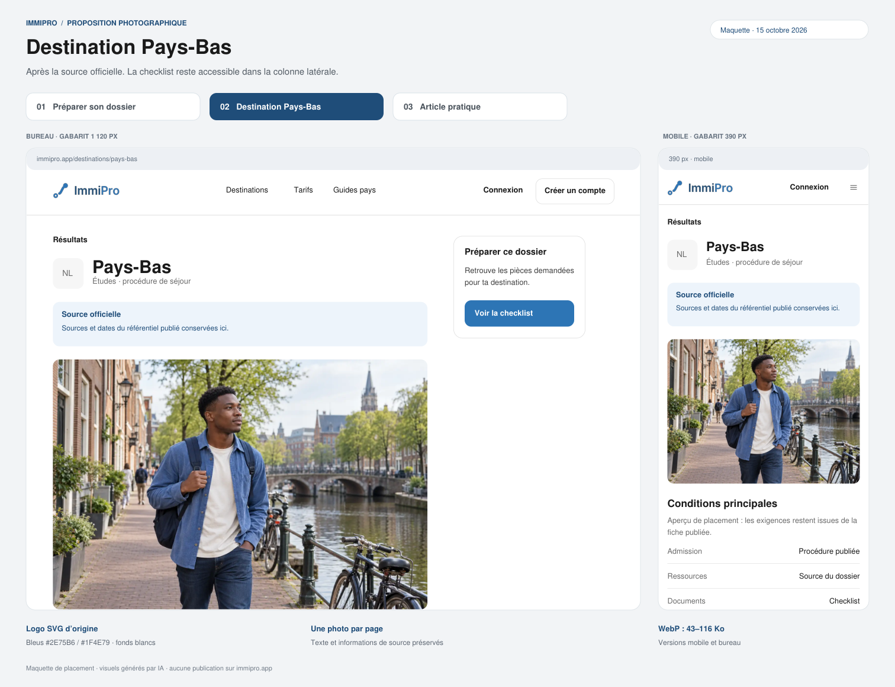
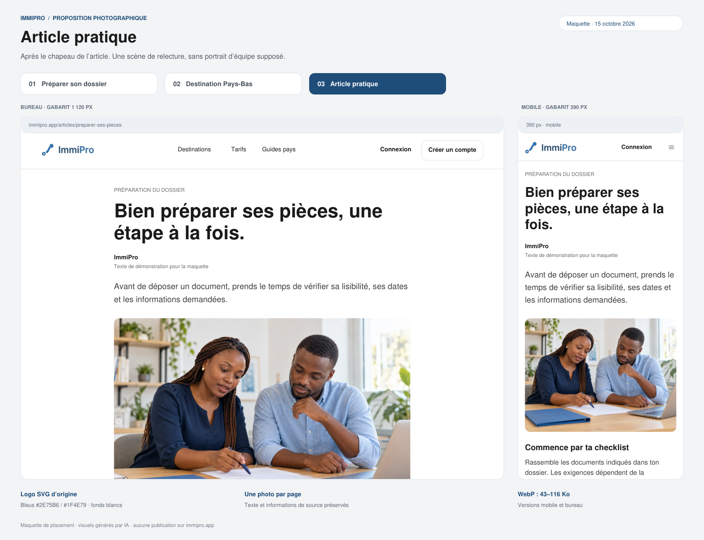

# ImmiPro — Galerie des images et propositions de placement

**Les trois premiers placements sont validés.** L’extension accueil et autres
pages attend la validation du responsable avant implémentation.

## Nouvelle proposition complète

**[Lire la proposition et le chantier d’implémentation](PROPOSITION-COMPLETE.md)**

[Inventaire des 62 gabarits](MATRICE-PAGES.md) · [Mesures des fichiers](mesures-proposition.json)

### 1. Accueil — nouveau

Photo à droite du simulateur sur bureau, sous son bouton sur mobile.

### 2. Catalogue des destinations — nouveau

### 3. Index des guides — nouveau

### 4. Guide pays — nouveau

### 5. Index des articles — nouveau

## Placements initiaux validés

### Comment ça marche

### Fiche destination Pays-Bas

### Article pratique

Ces planches sont des maquettes statiques, pas des captures du site publié.
Photos générées par IA, logo SVG d’origine conservé. Les contenus éditoriaux
sont des exemples ; aucun contenu réglementaire, code applicatif ou déploiement
modifié par cette branche de présentation.
